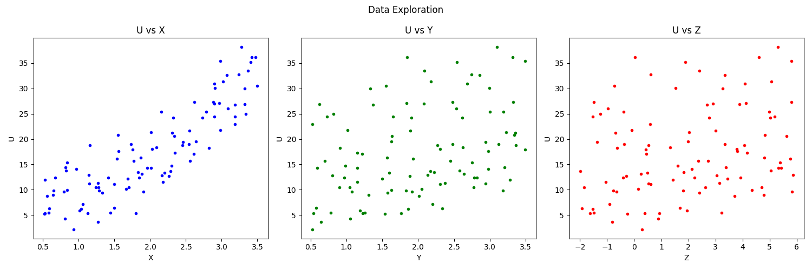

# Non-Linear Function Approximation and Hyperparameter Tuning using Multi-Layer Perceptrons (MLP)

An empirical deep learning study on approximating unknown, noisy, multivariable non-linear relationships using custom Multi-Layer Perceptrons (MLP) built with TensorFlow/Keras. The project systematically covers exploratory data analysis (EDA), leakage-free preprocessing, hyperparameter tuning across five distinct architectures, final generalization evaluation, and sensitivity sweep analyses.

---

## 🚀 Step-by-Step Guide: How to Proceed

To reproduce the experiments and review the results in the correct pedagogical order, follow this workflow:

```
[ master_nonlinear_mlp_dataset_1000.csv ]
                   │
                   ▼
       [ proj1-q (Notebook) ] ──(Generates)──► [ nonlinear_mlp_data_seed_17772130.csv ]
                                                                │
                                                                ▼
                                                       [ proj1-q.pdf ]
                                                                │
                                                                ▼
                           [ Non-Linear Function Approximation ... (MLP).ipynb ]
```

### 1. Step 1: Generate the Sampled Dataset
* Open and inspect the initial notebook **`proj1-q`** alongside the reference dataset **`master_nonlinear_mlp_dataset_1000.csv`** (containing 1,000 synthetic observations).
* Run the code in the `proj1-q` notebook using the designated group seed (derived from the student ID: `17772130`).
* Executing this notebook samples 100 observations to generate the dedicated project dataset:
  $$\text{Filename: } \texttt{nonlinear_mlp_data_seed_17772130.csv}$$

### 2. Step 2: Review Guidelines and Theoretical Prompts
* Read **`proj1-q.pdf`** thoroughly.
* This document outlines:
  * Constraints on sample sizes, training epochs ($\le 100$), and early stopping.
  * Rules on data isolation (70% Train, 15% Validation, 15% Test) to prevent data leakage.
  * Detailed theoretical questions embedded across Sections 1 to 7.

### 3. Step 3: Run the Complete Modeling & Analysis Notebook
* Open and execute **`Non-Linear Function Approximation and Hyperparameter Tuning using Multi-Layer Perceptrons (MLP).ipynb`**.
* This notebook contains the entire project lifecycle:
  * **Section 1:** Data loading, summary statistics, missing values, duplicate checks, and Z-score outlier detection.
  * **Section 2:** Exploratory visual analysis (scatter plots of $U$ versus $X$, $Y$, and $Z$).
  * **Section 3:** Train/Validation/Test split and feature standardization fit strictly on the training set.
  * **Sections 4 & 5:** Benchmark of 5 distinct MLP architectures (varying depth, activations, optimizers, and learning rates) with early stopping.
  * **Section 6:** Final evaluation of the top-performing model on the held-out test set (reporting MSE, MAE, and RMSE) and regression fit plots.
  * **Section 7 & Bonus:** Mathematical inferences regarding variable relationships and a controlled sensitivity sweep keeping two variables at their mean while sweeping the third.
  * Integrated theoretical answers written directly under each section.

---

## 📂 Repository Structure

```text
├── master_nonlinear_mlp_dataset_1000.csv                       # Reference pool of 1,000 samples
├── proj1-q                                                     # Initial notebook for student data extraction
├── proj1-q.pdf                                                 # Project specification and problem statement
├── nonlinear_mlp_data_seed_17772130.csv                        # Extracted 100-sample dataset (Seed: 17772130)
├── Non-Linear Function Approximation ... (MLP).ipynb           # Comprehensive implementation & report notebook
├── Data Exploration.png                                        # Scatter plots: U vs X, U vs Y, U vs Z
├── M4 test data x Training history.png                         # Loss curves & Test Actual vs Predicted plot
├── Controlled Sweep.png                                        # Sensitivity sweep curves for Z and X
└── README.md                                                   # Project documentation
```

---

## 🔬 Experimental Architecture Benchmark

Five neural network configurations were trained with early stopping ($\le 100$ epochs, patience $= 15$) and evaluated on the validation set:

| Model | Hidden Layers | Activation | Optimizer | Learning Rate | Batch Size | Validation MSE |
| :---: | :---: | :---: | :---: | :---: | :---: | :---: |
| **M1** | $[16, 8]$ | ReLU | Adam | $0.010$ | 32 | $3.0990$ |
| **M2** | $[32, 16]$ | tanh | Adam | $0.010$ | 32 | $14.3298$ |
| **M3** | $[32, 16, 8]$ | ReLU | SGD (Momentum $0.9$) | $0.010$ | 32 | $35.2275$ |
| **M4** | $[16, 8]$ | ReLU | SGD (Momentum $0.9$) | $0.001$ | 32 | **$0.8465$ (Best)** |
| **M5** | $[10]$ | tanh | Adam | $0.010$ | 64 | $52.9863$ |

### 🏆 Selected Champion Model: `M4`
* **Architecture:** Input ($3$) $\rightarrow$ Dense ($16$, ReLU) $\rightarrow$ Dense ($8$, ReLU) $\rightarrow$ Output ($1$, Linear)
* **Total Trainable Parameters:** $209$ parameters
  * Layer 1: $3 \times 16 + 16 = 64$
  * Layer 2: $16 \times 8 + 8 = 136$
  * Layer 3: $8 \times 1 + 1 = 9$

### 📊 Final Test Performance (Evaluated ONLY on Test Set)
* **Test MSE:** $0.887100$
* **Test MAE:** $0.791678$
* **Test RMSE:** $0.941860$

---

## 📈 Visual Findings & Sensitivity Analysis

### 1. Exploratory Data Analysis

* **$X$ vs $U$:** Displays a distinct upward, non-linear curvature.
* **$Y$ vs $U$ & $Z$ vs $U$:** No obvious 2D trend due to the confounding variance of other variables and added noise.

### 2. Model Convergence & Generalization

* The learning curves show rapid and stable loss minimization without diverging, indicating absence of severe overfitting or underfitting.
* The test prediction scatter plot aligns closely with the ideal identity diagonal line ($y = \hat{y}$).

### 3. Controlled Parameter Sweep

By clamping two variables to their dataset mean values and sweeping the third:
* **Sweep $Z$ (holding $X=1.99, Y=2.00$):** Yields a straight line, confirming that the underlying relationship between $Z$ and $U$ is **linear**.
* **Sweep $X$ (holding $Y=2.00, Z=2.01$):** Yields an upward-opening curve with increasing slope, confirming that the relationship between $X$ and $U$ is **non-linear (approximately quadratic)**.

---

## 🛠️ Installation and Environment Setup

1. **Clone the repository:**
   ```bash
   git clone https://github.com/KasraRezaeian/Non-Linear-Function-Approximation-and-Hyperparameter-Tuning-using-Multi-Layer-Perceptrons-MLP-.git
   cd Non-Linear-Function-Approximation-and-Hyperparameter-Tuning-using-Multi-Layer-Perceptrons-MLP-
   ```

2. **Install the required dependencies:**
   ```bash
   pip install numpy pandas matplotlib scipy scikit-learn tensorflow
   ```

3. **Launch Jupyter Notebook:**
   ```bash
   jupyter notebook
   ```
